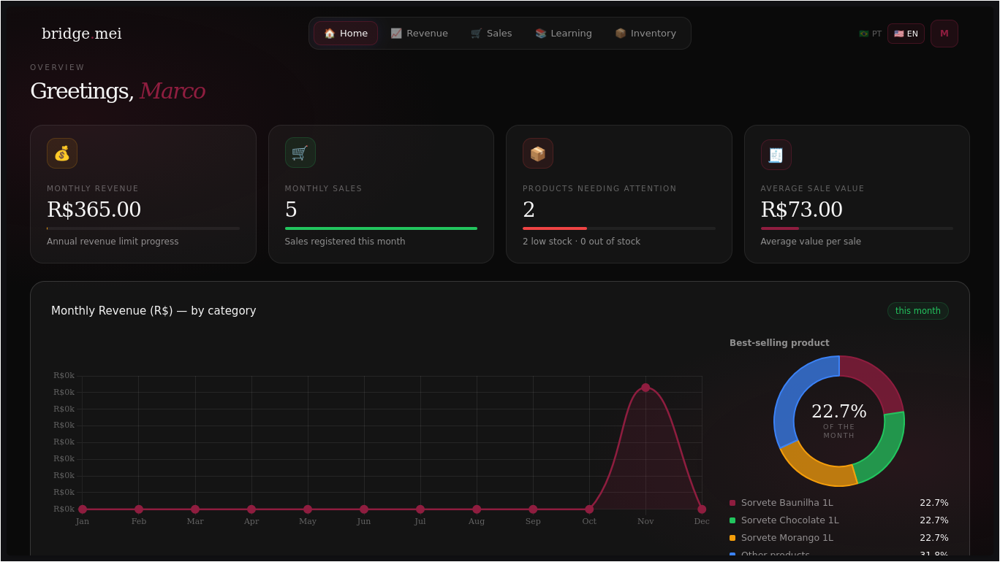
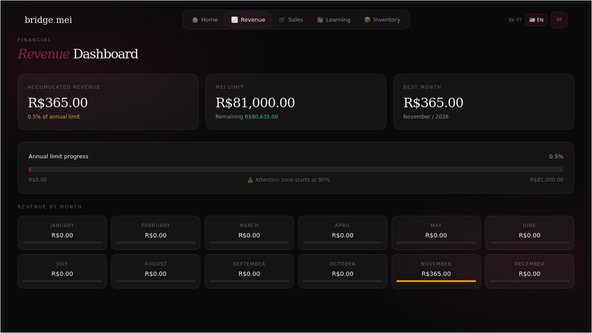
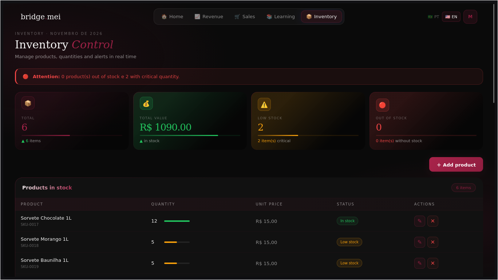
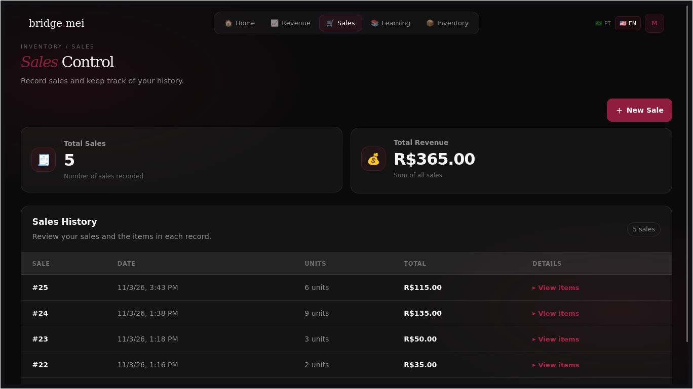
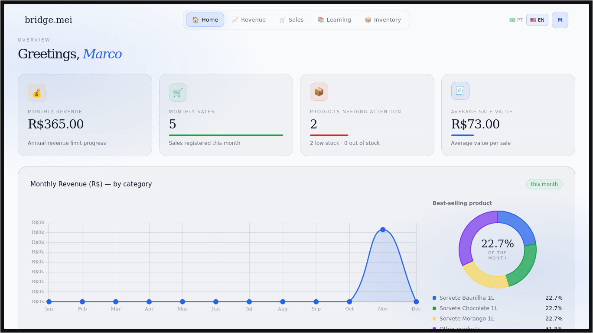

# BridgeMEI | Financial Management for MEIs

[🇧🇷 Português](README.md) | [🇺🇸 English](README.en.md)

**Developed by Enzo and Marcus — Etec-SP**

**BridgeMEI** is a simplified business management system designed to help Brazilian Individual Microentrepreneurs (MEIs) organize their day-to-day business information. It brings inventory management, sales records, revenue tracking, and educational content together in one interface. It is intended to support basic business organization: **it does not calculate taxes or issue invoices**, and it is not a substitute for accounting or tax software.

> This guide explains how to run the project locally. BridgeMEI does not have a publicly hosted instance. To use the application, you need to run it on your own computer with Docker.

## Overview

## Features

- **Dashboard:** business overview, sales and revenue indicators, charts, and best-selling product.

<p align="center">
  
</p>

- **Revenue tracking:** accumulated revenue, the MEI annual revenue limit, progress, and monthly figures.

<p align="center">
  
</p>

- **Inventory management:** create, edit, and remove products; update quantities; view low-stock alerts and movement history.

<p align="center">
  
</p>

- **Sales management:** record sales containing one or more products, browse sales history, and view the items in each sale. When a sale is registered, the corresponding inventory quantities are automatically deducted.

<p align="center">
  
</p>

- **Learning module:** educational content about topics related to MEIs.
- **Account and preferences:** user registration and login, Portuguese and English interface, and light and dark themes.

**Light theme:**

<p align="center">
  
</p>

## Technologies

| Layer | Technologies |
| --- | --- |
| Front end | React 19, Vite 8, JavaScript |
| APIs | C# and ASP.NET Core 10 |
| Database | MySQL 8 |
| Data access | Entity Framework Core |
| Authentication | JWT |
| Front-end web server | Nginx |
| Local environment | Docker and Docker Compose |

Docker Compose starts four services: the front end, authentication API, inventory/sales API, and MySQL database.

## Running the project

### Requirements

- [Docker Desktop](https://docs.docker.com/desktop/) with Docker Compose, or Docker Engine with the Docker Compose plugin.
- [Git](https://git-scm.com/) (optional if you prefer downloading the project as a ZIP file).

You do not need to install Node.js, .NET, or MySQL directly on your computer when running the project with Docker Compose. The project images include the required dependencies.

### 1. Download the project

Using Git:

```bash
git clone https://github.com/marcuss25/bridgemei.git
cd bridgemei
```

Alternatively, download the repository as a ZIP file from GitHub, extract it, and open a terminal in the project folder.

### 2. Configure environment variables

Create a `.env` file from the example:

Linux / macOS:

```bash
cp .env.example .env
```

Windows PowerShell:

```powershell
Copy-Item .env.example .env
```

Open `.env` and replace the example values for `MYSQL_ROOT_PASSWORD` and `MYSQL_APP_PASSWORD` with passwords of your choice. Do not share your `.env` file or commit real passwords to the repository.

### 3. Build and start the services

From the project root directory, run:

```bash
docker compose up -d --build
```

On the first run, Docker downloads the required images and builds the services. This may take a few minutes.

Check the container status:

```bash
docker compose ps
```

### 4. Open BridgeMEI

Once the services are running, open:

**http://localhost:5173**

Create an account on the registration screen and sign in.

## Ports

| Service | Local address | Host port |
| --- | --- | ---: |
| Web application | [http://localhost:5173](http://localhost:5173) | 5173 |
| Authentication API | [http://localhost:5009](http://localhost:5009) | 5009 |
| Inventory and sales API | [http://localhost:5017](http://localhost:5017) | 5017 |
| MySQL | `localhost:3307` | 3307 |

If one of these ports is already in use by another application, free the port or change the corresponding mapping in `docker-compose.yml`.

## Useful commands

Check running services:

```bash
docker compose ps
```

Follow logs from all services:

```bash
docker compose logs -f
```

Follow logs from a specific service:

```bash
docker compose logs -f frontend
```

Rebuild and start the services after making changes:

```bash
docker compose up -d --build
```

Stop the services:

```bash
docker compose down
```

**Note:** `docker compose down` preserves database data in the Docker volume named `mysql_data`. To also remove the database volume and start from scratch, run:

```bash
docker compose down -v
```

This command removes the database volume and permanently deletes the data stored in it. Only use it if you intend to reset the environment.

## Troubleshooting

**The application does not open at `localhost:5173`**
- Make sure Docker is running.
- Run `docker compose ps` and check whether the services are up.
- Review the logs with `docker compose logs -f`.

**A service fails to start or a port is already in use**
- Check whether the ports listed above are available.
- Inspect the specific error with `docker compose logs -f service-name`.
- After fixing the issue, run `docker compose up -d --build` again.

**The database rejects the credentials after editing `.env`**
- MySQL stores its data and users in the persistent volume. Changing values in `.env` does not automatically recreate a database that has already been initialized.
- If you want to discard the data and initialize the database again, run `docker compose down -v`, followed by `docker compose up -d --build`. This deletes the existing data.

## About this version

**MEI (Microempreendedor Individual)** is a Brazilian legal category for eligible individual microentrepreneurs, with its own registration, tax, and business rules under Brazilian law. These rules are specific to Brazil and may not match the requirements that apply to small businesses or self-employed people in other countries. BridgeMEI's terminology and features are therefore based on the Brazilian MEI context; they should not be assumed to apply worldwide.

BridgeMEI is a school project developed by students from Etec-SP. It is a simplified management tool, not an accounting or tax platform: it does not calculate taxes or issue invoices. The application is provided for local execution and project evaluation. This repository does not provide a hosted service, cloud synchronization, or remote operational support.

Data is stored in the MySQL database running through Docker on the user's computer. Keep your `.env` file private and make backups of any data you want to preserve.

---

[🇧🇷 Ler em português](README.md) · [🇺🇸 Read in English](README.en.md)
