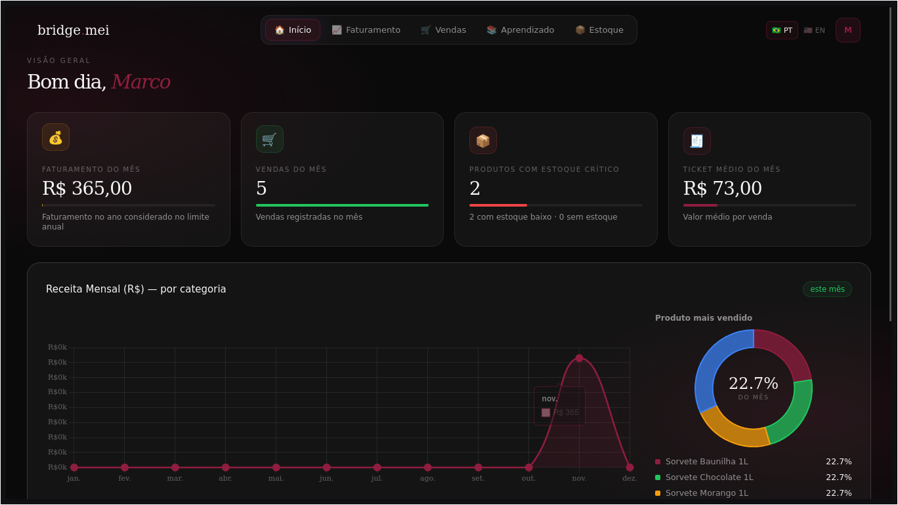
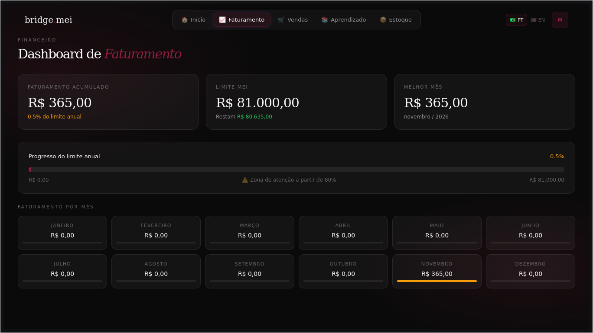
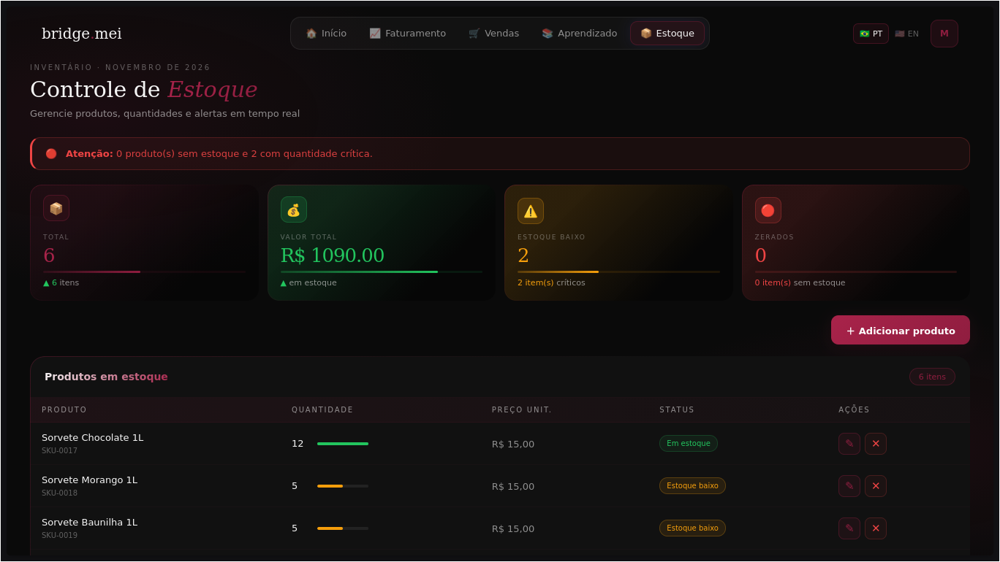
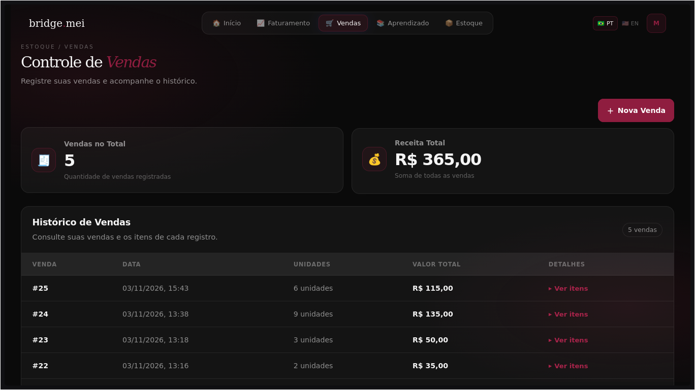
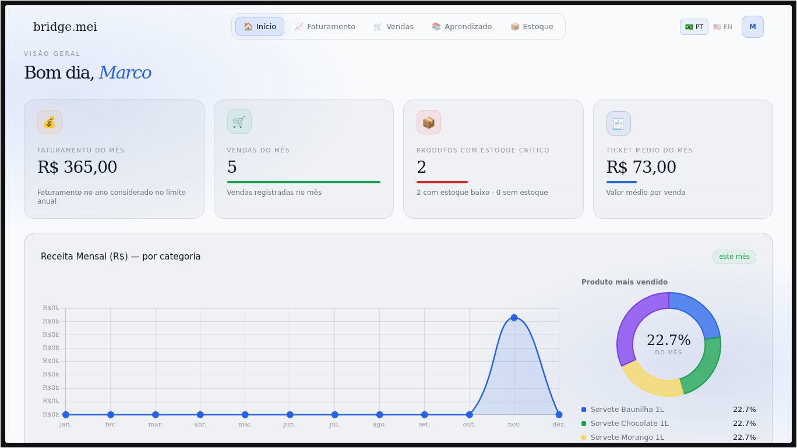

# BridgeMEI | Gestão Financeira para MEIs

[🇧🇷 Português](README.md) | [🇺🇸 English](README.en.md)

**Desenvolvido por Enzo e Marcus — Etec-SP**

O **BridgeMEI** é um sistema simplificado de gestão para Microempreendedores Individuais (MEIs), criado para ajudar na organização das informações e na rotina do negócio. O projeto reúne controle de estoque, registro de vendas, acompanhamento de faturamento e conteúdos educativos em uma única interface. Seu objetivo é apoiar a gestão cotidiana: **não calcula impostos nem emite notas fiscais**, e não substitui sistemas contábeis ou fiscais.

> Esta documentação descreve como executar o projeto localmente. O BridgeMEI não possui uma instância pública hospedada: para utilizar a aplicação, é necessário executá-la no próprio computador com Docker.

## Visão geral

## Funcionalidades

- **Dashboard:** visão geral do negócio, indicadores de vendas e faturamento, gráficos e produto mais vendido.

<p align="center">
  
</p>

- **Faturamento:** acompanhamento do faturamento acumulado, limite anual do MEI, progresso e valores por mês.

<p align="center">
  
</p>

- **Controle de estoque:** cadastro, edição e remoção de produtos, atualização de quantidades, alertas de estoque baixo e histórico de movimentações.

<p align="center">
  
</p>

- **Controle de vendas:** registro de vendas com um ou mais produtos, consulta ao histórico e visualização dos itens de cada venda. Ao registrar uma venda, as quantidades correspondentes são descontadas do estoque.

<p align="center">
  
</p>

- **Módulo de aprendizado:** conteúdos informativos sobre temas relacionados ao MEI.
- **Acesso e preferências:** cadastro e login de usuários, interface em português e inglês e temas claro e escuro.

**Tema claro:**

<p align="center">
  
</p>

## Tecnologias

| Camada | Tecnologias |
| --- | --- |
| Front-end | React 19, Vite 8, JavaScript |
| APIs | C# e ASP.NET Core 10 |
| Banco de dados | MySQL 8 |
| Persistência e acesso a dados | Entity Framework Core |
| Autenticação | JWT |
| Servidor web do front-end | Nginx |
| Ambiente local | Docker e Docker Compose |

O Docker Compose inicia quatro serviços: front-end, API de autenticação, API de estoque/vendas e banco de dados MySQL.

## Como executar

### Pré-requisitos

- [Docker Desktop](https://docs.docker.com/desktop/) com Docker Compose, ou Docker Engine com o plugin Docker Compose.
- [Git](https://git-scm.com/) (opcional, caso prefira baixar o projeto como ZIP).

Não é necessário instalar Node.js, .NET ou MySQL diretamente no computador quando o projeto é executado pelo Docker Compose. As imagens do projeto incluem as dependências necessárias.

### 1. Baixe o projeto

Com Git:

```bash
git clone https://github.com/marcuss25/bridgemei.git
cd bridgemei
```

Ou baixe o repositório em ZIP pelo GitHub e extraia os arquivos. Abra o terminal na pasta do projeto.

### 2. Configure as variáveis de ambiente

Crie o arquivo `.env` a partir do exemplo:

Linux / macOS:

```bash
cp .env.example .env
```

Windows PowerShell:

```powershell
Copy-Item .env.example .env
```

Abra o arquivo `.env` e substitua os valores de exemplo de `MYSQL_ROOT_PASSWORD` e `MYSQL_APP_PASSWORD` por senhas de sua escolha. Não compartilhe seu arquivo `.env` nem publique senhas reais no repositório.

### 3. Construa e inicie os serviços

Na pasta raiz do projeto, execute:

```bash
docker compose up -d --build
```

Na primeira execução, o Docker fará o download das imagens necessárias e construirá os serviços. Esse processo pode levar alguns minutos.

Para verificar o estado dos containers:

```bash
docker compose ps
```

### 4. Acesse o BridgeMEI

Quando os serviços estiverem em execução, abra:

**http://localhost:5173**

Crie uma conta pela tela de cadastro e entre com suas credenciais.

## Portas utilizadas

| Serviço | Endereço local | Porta no computador |
| --- | --- | ---: |
| Aplicação web | [http://localhost:5173](http://localhost:5173) | 5173 |
| API de autenticação | [http://localhost:5009](http://localhost:5009) | 5009 |
| API de estoque e vendas | [http://localhost:5017](http://localhost:5017) | 5017 |
| MySQL | `localhost:3307` | 3307 |

Se alguma dessas portas já estiver sendo utilizada por outro programa, será necessário liberar a porta ou ajustar o mapeamento correspondente em `docker-compose.yml`.

## Comandos úteis

Verificar os serviços:

```bash
docker compose ps
```

Acompanhar os logs de todos os serviços:

```bash
docker compose logs -f
```

Acompanhar os logs de um serviço específico:

```bash
docker compose logs -f frontend
```

Reconstruir e iniciar os serviços após alterações:

```bash
docker compose up -d --build
```

Parar os serviços:

```bash
docker compose down
```

**Atenção:** `docker compose down` mantém os dados do banco no volume Docker `mysql_data`. Para apagar também o banco e começar do zero, utilize:

```bash
docker compose down -v
```

O comando acima remove o volume do banco e apaga os dados armazenados nele. Use-o somente se realmente quiser reiniciar o ambiente sem os dados anteriores.

## Solução de problemas

**A aplicação não abre em `localhost:5173`**
- Confira se o Docker está iniciado.
- Execute `docker compose ps` e verifique se os serviços estão em execução.
- Consulte os logs com `docker compose logs -f`.

**Um serviço não inicia ou a porta já está em uso**
- Verifique se as portas listadas acima estão livres.
- Consulte o erro específico com `docker compose logs -f nome-do-serviço`.
- Depois de corrigir o problema, execute novamente `docker compose up -d --build`.

**O banco de dados não aceita as credenciais depois de alterar o `.env`**
- O MySQL mantém seus dados e usuários no volume persistente. Alterar as variáveis no `.env` não recria automaticamente um banco que já foi inicializado.
- Se você deseja descartar os dados e iniciar o banco novamente, execute `docker compose down -v` e depois `docker compose up -d --build`. Isso apaga os dados existentes.

## Sobre esta versão

O BridgeMEI é um projeto acadêmico desenvolvido por estudantes da Etec-SP. A aplicação é disponibilizada para execução local e avaliação do projeto; não há serviço de hospedagem, sincronização em nuvem ou suporte operacional remoto oferecido pelo repositório.

Os dados ficam no banco MySQL executado pelo Docker na máquina do usuário. Preserve o arquivo `.env` e mantenha cópias de segurança dos dados que desejar guardar.

---
**
[🇧🇷 Ler em português](README.md) · [🇺🇸 Read in English](README.en.md)
