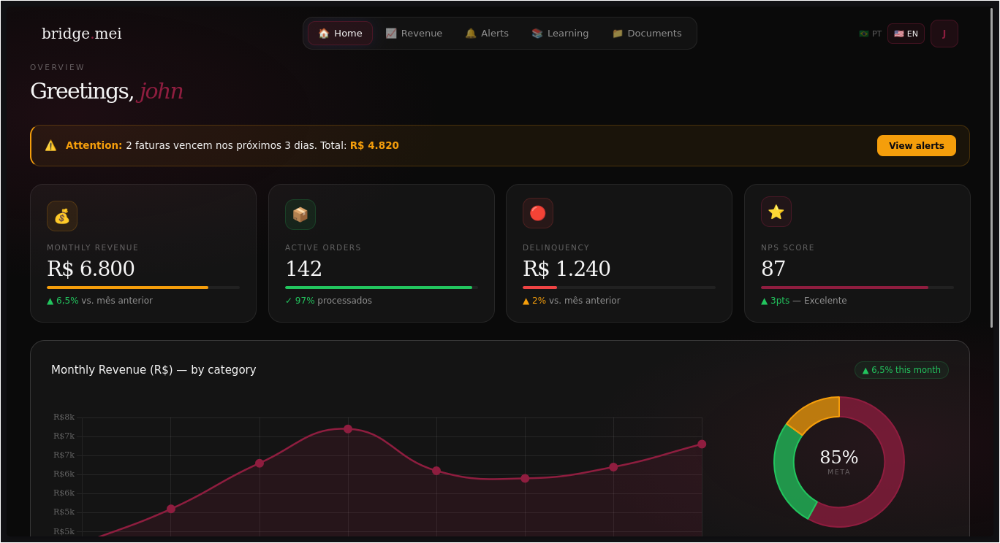

 

# BridgeMEI | Gestão Financeira    

_Desenvolvido por: Enzo e Marcus_

*O BridgeMEI ainda não foi publicado, mas continuaremos com o projeto aqui no github mesmo após o lançamento.*

##  Sumário
  - [Sobre](#sobre)
  - [O que vem nele?](#o-que-vem-nele)
  - [Novidades](#novidades)
  - [Tecnologias utilizadas](#tecnologias-utilizadas)
  - [Como testar](#como-testar)
  - [Etapas de Desenvolvimento](#etapas)

## Sobre
BridgeMEI é um MVP(produto mínimo viável) de gestão financeira, o qual tem diversas funcionalidades.  
Por exemplo: você pode olhar o faturamento do seu negócio de forma dinâmica, fazer o controle do seu estoque e muito mais.



## Novidades
Chegou uma funcionalidade nova no BridgeMEI!

**Controle de Vendas**

Agora, e possivel registrar as vendas do seu negocio pelo site, e ele mostra todos os itens em estoque e o historico das vendas.
Quando uma venda e registrada o site faz a baixa no estoque automaticamente, sem que o usuario precise fazer isso.


## O que vem nele?
O BridgeMEI possui alguns recursos para facilitar a vida de um MEI, como:
- Dashboard
- Aba de Faturamento
- Guia de Aprendizado
- Controle de Estoque
- Controle de Vendas (em breve)

## Tecnologias utilizadas
* Front-end: React.js
* Back-end: C# (ASP.NET Core)
* Banco de Dados: MySQL

Outras Ferramentas:
* JWT authenticator
* Docker e Docker Compose

## Como testar
Pré-requisitos:
- Git
- Docker Engine ou Docker Desktop
- Docker Compose

Para garantir que o site abra sem dificuldades, siga o passo-a-passo na ordem correta.

Links para a instalacao das ferramentas: 

* [Git](https://git-scm.com/install/windows) 
* [Docker](https://www.docker.com/products/docker-desktop/)

### 1- Clone o repositório
No computador, abra o terminal e digite:

```
git clone https://github.com/EnzoTakeshi588/bridgemei
cd bridgemei
```
### 2- Altere o ```.env```

Renomeie o arquivo ```.env.example``` para ```.env```.

O arquivo ```.env``` possui as senhas do MySQL predefinidas, você pode alterá-las ou manter como está.

### 3- Inicialize o projeto

Na raiz do projeto, execute:
```
docker compose up -d --build
```
O Docker Compose irá carregar os componentes necessários do projeto.

### 4- Acesse o site

Após os serviços serem inicializados, acesse no seu navegador:  
http://localhost:5173

### 5- Primeiro acesso

Abra o site, realize o cadastro e entre com as suas credenciais.

Para rodar o projeto, use:
```
docker compose up
``` 

Para parar, use:
```
docker compose down
```

## Etapas
Projeto Inteiro:
* ~~Criação do BridgeMEI~~
* ~~Criação da tela Mei~~
* ~~Criação da API Login~~
* ~~Criação da tela Estoque~~
* ~~Criação da API Estoque~~
* ~~Tabela do estoque relacional~~
* ~~Adição de temas novos~~
* ~~Docker Compose~~
* ~~Implementacao Controle de Vendas~~
* Tela de Faturamento funcional 
* Release BridgeMEI v1.0

_O BridgeMEI é um projeto escolar, feito por estudantes da Etec-SP_
